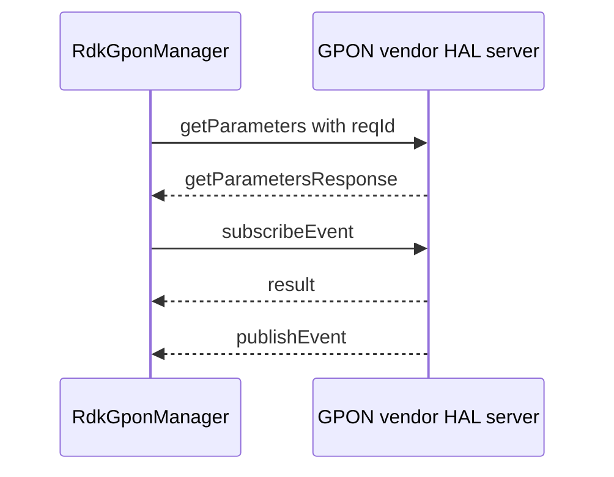

# GPON JSON HAL Specification

## Version History

| Date | Comment | Version |
| --- | --- | --- |
| — | Documentation alignment; schemas unchanged. | — |

## Acronyms

HAL means Hardware Abstraction Layer; GPON means Gigabit Passive Optical Network; ONT means Optical Network Terminal; VEIP means Virtual Ethernet Interface Point.

## Description

RdkGponManager consumes the JSON HAL contract for ONT identity, optical status and alarms, registration, VEIP, and configuration.

| Schema contract | Consuming component | Selection |
| --- | --- | --- |
| `gpon_hal_schema.json` | RdkGponManager | Standard product configuration. |
| `gpon_wan_unify_hal_schema.json` | RdkGponManager | WAN-unified product configuration. |

These are alternative product contracts, not combined parameter sets. Both advertise module `gponhal`, version `0.0.1`; select the installed variant through product configuration. See the [detailed protocol reference](halSpecDetailed.md).

## Component Runtime Execution Requirements

### Initialization and Process Model

Deploy the selected schema and start its vendor server before RdkGponManager requests. Both product configurations use port `40100` with different installed schema paths. Communication uses the shared JSON HAL library over IPv4 TCP.

### Threading and Memory Model

Serialize shared client control and teardown. Manage C-side JSON objects according to json-c ownership rules; copy callback data needed after notification processing.

### Asynchronous Notification Model

Use `subscribeEvent` and `publishEvent` for supported optical alarms, registration, and VEIP events. Resolve the subscription constraints described in the detailed reference before use.

### Blocking Calls

Synchronous library requests wait for a reply or timeout. A timeout does not cancel remote hardware work.

### Error Reporting

Check transport/library status separately from wire `Result.Status`. Validate the selected schema before classifying failures as vendor hardware errors.

## Nonfunctional Requirements

### Logging and Debugging

Implementations must not log credentials, secrets, security-sensitive information, or other sensitive data. Log operation outcomes rather than payloads.

### Build and Quality Requirements

Use the product build integration and compatible JSON HAL library. Match the deployed schema to configuration, preflight schema references, and validate changes with product-approved restoration procedures.

## Interface API Documentation

The [detailed reference](halSpecDetailed.md) describes all eleven actions and the action-specific parameter indexes. Determine read, write, and event eligibility from the selected schema rather than parameter names alone.

## Sequence Diagram

## Source References

- [Standard schema](https://github.com/rdkcentral/gpon-manager/blob/main/hal_schema/gpon_hal_schema.json)
- [WAN-unified schema](https://github.com/rdkcentral/gpon-manager/blob/main/hal_schema/gpon_wan_unify_hal_schema.json)
- [Standard configuration](https://github.com/rdkcentral/gpon-manager/blob/main/config/gpon_manager_conf.json)
- [WAN-unified configuration](https://github.com/rdkcentral/gpon-manager/blob/main/config/gpon_manager_wan_unify_conf.json)
- [Component build identity](https://github.com/rdkcentral/gpon-manager/blob/main/configure.ac)
